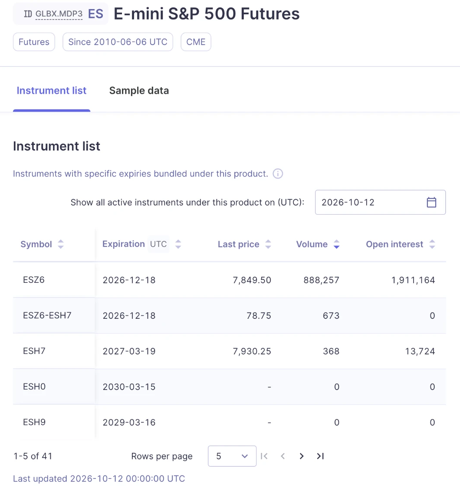

## 总结

- **数据从哪里来**：从 [Databento](https://databento.com) 购买，数据集是 CME 官方行情 **CME Globex MDP 3.0**（代码 `GLBX.MDP3`），品种是 ES（标普 500 E-mini 期货）的连续合约 `ES.c.0`，**1 分钟 K 线**，时间从 2010 年 6 月到 2026 年 9 月。
- **价格本身是干净的**：没有缺失值、没有重复时间、没有不合理的高低价，所有价格都落在 0.25 的最小跳动单位上。
- **真正的问题出在“哪些日子不能用”**，我删掉了三类日子：
  1. **换合约前后几天**（66 次）：新旧合约价格对不上，交割日白天还完全没有数据；
  2. **节假日和半日市**（124 天）：股市休市只有期货开盘，或者 13:00 就提前收盘；
  3. **数据有问题的日子**（14 天）：数据源中间缺一大段，或者夜盘被假期拉长到包含好几个晚上。
- **结果**：剩下 **3924 个**白盘完整的交易日，只损失约 2%。以后所有研究都基于这份数据。

## 数据从哪里来

CME Globex MDP 3.0 是芝加哥商品交易所（CME）的官方行情数据源，Globex 上交易的所有期货、期权都从这里发出。Databento 从 2010 年 6 月 6 日开始收录这份数据，按用量收费，我当时下载 1 分钟 K 线花了大约 20 美元。

我下载的具体内容：

| 项目 | 选择 |
|---|---|
| 数据集 | CME Globex MDP 3.0（`GLBX.MDP3`） |
| 品种 | ES，E-mini S&P 500 期货 |
| 合约 | `ES.c.0`，连续合约（见下文） |
| K 线 | OHLCV-1m，也就是 1 分钟的开高低收和成交量 |
| 时间范围 | 2010-06 ～ 2026-09 |
| 格式 | CSV |

### 为什么要用“连续合约”

ES 不是一个合约，而是**每个季度一个**：ESZ6 是 2026 年 12 月到期，ESH7 是 2027 年 3 月到期，以此类推。每个合约只在到期前的几个月里是主力。

要研究 16 年的走势，就得把这些合约首尾接起来。`ES.c.0` 就是 Databento 自动接好的“连续合约”：永远取当前最近到期的那一个，到期后自动换到下一个。这个“自动换”正是后面最大的坑。

## 价格本身是干净的

我检查了全部约 550 万行 1 分钟 K 线：

| 检查项 | 结果 |
|---|---|
| 缺失值 / 重复时间 | 0 / 0 |
| 最高价低于开收盘、最低价高于开收盘 | 0 |
| 不在 0.25 最小跳动单位上的价格 | 0 |
| 极端大 K 线 | 抽查都对得上真实事件，比如 2020 年熔断、2025-04-09 关税暂停 |
| 用 SPY 独立核对（2023–2024，约 8000 根 K 线） | ES 与 SPY 的价格比值最大偏离 0.23%，没发现错价 |

## 真正的问题：哪些日子不能用

### 1. 换合约前后（66 次）

`ES.c.0` 是在**交割周五之后的那个周日晚上**才换到新合约的。可旧合约在交割周五早上 9:30 就停止交易了，所以：

- **交割周五的白天完全没有数据**；
- 程序找周一的夜盘时，会一路往前找到周四晚上，把“周四晚上（旧合约）+ 周日晚上（新合约）”拼成一个夜盘。新旧合约价格通常差十几到几十点，最多差过 224 点，拼出来的夜盘高低点是假的。

**处理**：每次换约，删掉从周四晚上到换约后周一收盘这一段。周一整天删掉，周二完整保留。

特例：2026 年 6 月的交割日碰上六月节（6/19 周五休市），交割提前到周四，当晚就换了合约，处理时单独考虑。

### 2. 节假日和半日市（124 天）

- **股市休市、只有期货开半天**：马丁·路德·金纪念日、总统日、阵亡将士纪念日、7 月 4 日、劳动节、感恩节、六月节。这些天股票市场根本没开，成交量只有平时的 1–10%；
- **股市 13:00 提前收盘**：感恩节第二天、7 月 3 日、平安夜。只有半天，和完整交易日不可比。

### 3. 数据有问题的日子（14 天）

| 情况 | 天数 | 例子 |
|---|---|---|
| 数据源中间缺一大段 | 3 | 2020-02-28 上午 10:58 之后直到周日晚上都没有数据 |
| 夜盘被假期拉长，包含好几个晚上 | 8 | 耶稣受难日股市休市但期货开了早盘；飓风桑迪股市停了两天；两次总统国葬 |
| 整天缺失之后的第一天 | 3 | 源数据里 2014 年有 6 个正常交易日整天缺失，它们后面那一天的“昨天”会取错 |

## 清洗结果

| | 结果 |
|---|---|
| 完整交易日 | **3924 天**，每天白盘都完整（09:30–15:59，390 根 1 分钟 K 线） |
| 损失 | 约 2% 的交易日 |
| 混入两个合约的夜盘 | 0 |
| 包含多个晚上的夜盘 | 0 |

## 局限

- **交割前一周用的是快到期的旧合约**，成交量只有新合约的约 1/4。研究价格结构影响不大，研究成交量时要排除这几天；
- **价格没有复权**，换合约时价格会跳一下。看百分比没问题，但不要拿不同年份的绝对点数直接比较；
- **2017 年 5 月 21 日之前的数据来自交易所的历史文件**，没有 Databento 自己的采集时间戳。对 1 分钟 K 线影响不大，但值得知道；
- **有 46 天夜盘数据不完整**，白盘是正常的，所以没有删。做夜盘研究时要单独过滤。

## 我怎么用它

以后每一篇研究都基于这份清洗后的数据，文章里不再重复说明。清洗规则写成了一个脚本，有新数据时重新跑一遍即可。

（补充说明：2026 年 10 月补充下载了 2026 年 4–9 月的数据，文中的时间范围和数字已按合并后的数据更新。）
