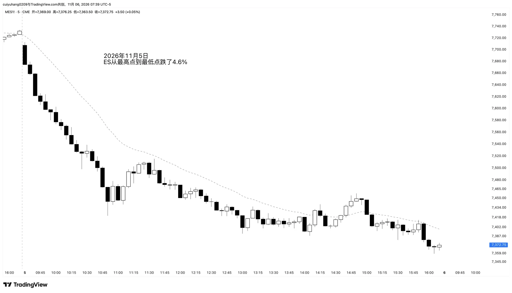

import ImageCases from "@/components/ImageCases.astro";
import ResearchCard from "@/components/ResearchCard.astro";
import prompt from "./prompt.en.txt?raw";
import code from "./open-selloff.en.py?raw";

export const picks = Object.entries(import.meta.glob("./picks/*.webp", { eager: true, import: "default" }))
  .sort(([a], [b]) => (a < b ? -1 : 1))
  .map(([path, img]) => {
    const d = path.slice(-15, -5);
    const w = ["Sun", "Mon", "Tue", "Wed", "Thu", "Fri", "Sat"][new Date(d + "T12:00:00Z").getUTCDay()];
    return { img, alt: `${d} opening selloff`, note: `<b>${d} ${w}</b>` };
  });

> **Bottom line**: within the first 20 five-minute bars of the ES RTH session, a relentless selloff, with almost every bar a bear bar and the highs stepping lower, happened on **260 days** in 16 years, about 16 times a year. After the selloff ends, the rest of the day is **53% trading range, 26% trend resumption and 20% reversal**. Al Brooks says 60 / 20 / 20, and the data is close.

Al Brooks has a rule of thumb: when a day opens with a big selloff, about 60% of the time the rest of the day is a trading range, 20% a big reversal and 20% a trend resumption.

What I wanted to test is a more specific kind of open. Not just any day that falls a lot, but one that gets sold **without letup** from the open: a dozen or more bars, almost all bear bars, with only small bull bars in between, the highs stepping lower one after another, and hardly any real bounce. Like this day:

5-minute chart, 2026-11-05. Bar 1 was a big bear bar, and almost every bar after it was a bear bar, selling off until about 10:50. After a bounce to 11:30 it started grinding lower again and closed near the low of the day. It fell 4.6% from high to low.

This post asks: once a selloff like this ends, what kind of follow-through comes next?

## 1. What counts as a "relentless selloff"

I'm looking for days that get sold all the way down soon after the open. They come in roughly two shapes. Either one counts, and both together is the classic case:

- **A few very big bear bars**: three to five big bear bars knock it down a long way at once.
- **One modest bear bar after another**: no single bar is big, but they keep going down with almost no bounce in between.

Either way, there are very few bull bars, and the ones there are stay small.

To test this on 16 years of data, I turned the idea into 6 rules ("the leg" means this selloff from its highest point to its lowest point):

1. It happens soon after the open: the selling starts between bar 1 and bar 10 and is over by bar 22 at the latest.
2. The leg is at least 6 bars; if it's under 10 bars, every bar has to be a bear bar.
3. Few bull bars: at least two thirds are bear bars, and no bull bar's body is more than a tenth of the whole leg, so the bull bars can only be small ones.
4. At least 8 bars in a row in the middle with no real bull bar.
5. Lower highs: at least three quarters of the bars have a high below the previous bar's high. Even when it bounces along the way, no close gets back 20% of the leg, and no high reaches 35%.
6. A big enough drop: what it loses within the first 20 bars is at least 60% of that year's typical daily range.

## 2. The 155 days I picked by hand

The 6 rules picked out more than 300 days. I then screened them by hand twice, on two criteria: either a few big bear bars hit especially hard, or the selling pressure kept going with hardly any bull bars in between.

<ImageCases title="The 155 opening selloffs I picked by hand" items={picks} />

## 3. Trading range 53%, trend resumption 26%, reversal 20%

After the selloff ends, I sort each day into three groups by where it **closes**:

- **Trend resumption**: the close is below the leg's low, by at least a quarter of the leg.
- **Reversal**: the close gets back at least 80% of the leg.
- **Trading range**: the close is in between.

| Cutoffs (trend resumption / reversal) | Trend resumption | Trading range | Reversal |
|---|---:|---:|---:|
| **0.25 legs below / back 80% (used here)** | **26%** | **53%** | **20%** |
| Below the low / back 80% | 35% | 45% | 20% |
| 0.5 legs below / back 80% | 19% | 60% | 20% |
| 0.25 legs below / back 70% | 26% | 49% | 25% |
| 0.25 legs below / all the way back | 26% | 58% | 15% |

However the cutoffs move, the trading range stays around half, and trend resumption and reversal each take 20% to 30%. Brooks's 60 / 20 / 20 basically holds.

What each group looks like:

| After the selloff | Trend resumption | Trading range | Reversal |
|---|---:|---:|---:|
| Days | 68 | 139 | 53 |
| New low | 100% | 76% | 49% |
| How much further down (median) | 0.96 legs | 0.18 legs | 0 |
| Biggest bounce (median) | 0.41 legs | 0.68 legs | 1.59 legs |
| Close (median) | −0.69 legs | 0.32 legs | 1.33 legs |
| Size of the selloff (median) | 1.03% | 0.81% | 0.79% |

- **The 26% that resume the trend**: they make almost another full leg (a measured move, AB = CD), with bounces of less than half along the way. The selloff itself is bigger too, a median of 1.03%. The median time of breaking a quarter of a leg below the low is 12:35, but the low of the day comes after 14:00 on 91% of these days and in the last hour on 79%: the selling goes all the way into the close. A common look on the chart: after the selloff ends it goes sideways for an hour or two, then breaks lower in the afternoon.
- **The 53% trading range days**: most still make a small new low (0.18 legs), bounce to about 70% of the leg, and close about 30% above the low.
- **The 20% that reverse**: half of them never make a new low, so the selloff's low is the low of the day. The median bounce is 1.59 legs, closing above where the selloff started. The median time to get back 80% is 12:40, and 38% only get there after 14:00: reversals mostly grind up rather than V up.

## 4. Follow-through after the selloff

- **A quick new low, but not far**: 77% make a new low, with a median of only another 0.25 legs; seven in ten do it within half an hour.
- **Bounces mostly reach halfway**: 67% reach half the leg and 40% reach 80%; but half of those that reach 80% can't hold it into the close.
- **The low usually gets tested, and the test usually breaks it a little**: 71% come back to test the low, and 63% of those break it a bit, but not by much.
- **The low of the day**: 23% of the time it's the selloff's low, and 28% of the time it comes after 15:00, mostly on trend resumption days.

## 5. A new low within the next hour?

Wait an hour (12 bars) after the selloff ends, and the three groups shift a lot:

| Within 1 hour after it ends | Days | Trend resumption | Trading range | Reversal |
|---|---:|---:|---:|---:|
| New low of ≥0.25 legs | 43 | **51%** | 42% | 7% |
| No new low | 98 | 16% | 54% | **30%** |
| Bounce of ≥0.5 legs | 92 | 17% | 49% | **34%** |

- A new low of more than a quarter of a leg within the hour: trend resumption rises to 51%, and reversal falls to 7%.
- No new low within the hour, or a bounce of more than half: reversal rises to about 30%.

Nothing special the next day: 57% close up, close to the usual 55%; 52% break today's low.

## 6. What it means for trading

- **Don't sell the moment the selloff ends**: more than half the time it turns into a trading range.
- **Don't rush to buy the bottom either**: 77% still make a new low. Put the stop about a quarter of a leg below the low.
- **Look for half on the bounce first**: 67% reach half, 40% reach 80%.
- **A test of the low usually breaks it a little**: waiting for the break and the reclaim before buying is steadier than buying a double bottom right at the low.
- **Check for a new low an hour later**: a new low of more than a quarter of a leg, get ready for a trend resumption; no new low and a bounce of more than half, a reversal becomes more likely.

## Definition and how to reproduce it

<ResearchCard title="After a relentless opening selloff" prompt={prompt} code={code}>

- **Data**: cleaned 1-minute ES bars, 2010-06 to 2026-09, 3,924 trading days. See [how I cleaned it](/en/posts/data-cleaning/).
- **RTH**: 09:30–16:15 US Eastern, built into 5-minute bars, 81 bars a day.
- **Relentless opening selloff**: the 6 rules in section 1. When several cuts on the same day qualify, the one that falls the most is used.
- **Leg**: from the high of the bar where the selloff starts to the low of the bar where it ends. Every "legs" figure in the post uses it as the ruler: 0 is the leg's low, 1 is where the leg started, and negative numbers are new lows.
- **Three groups**: a close below −0.25 is trend resumption, 0.8 or above is reversal (the same "back 80%" I use for a reversal in day types), and anything in between is a trading range.
- **New low / how much further down**: the day's low after the leg ends is below the leg's low; how far below, divided by one leg. **Biggest bounce**: the day's high after the leg ends minus the leg's low, divided by one leg.
- **Testing the low**: after the leg ends, first a bar's high reaches the low + 0.3 legs or more, then a later bar's low comes back to within the low + 0.1 legs. After that, a drop below the low − 0.1 legs counts as "broken".
- **One hour after it ends**: the 12 bars after the leg ends.
- **Next day**: must be on the same contract as today, with no cleaned-out days in between.

</ResearchCard>
