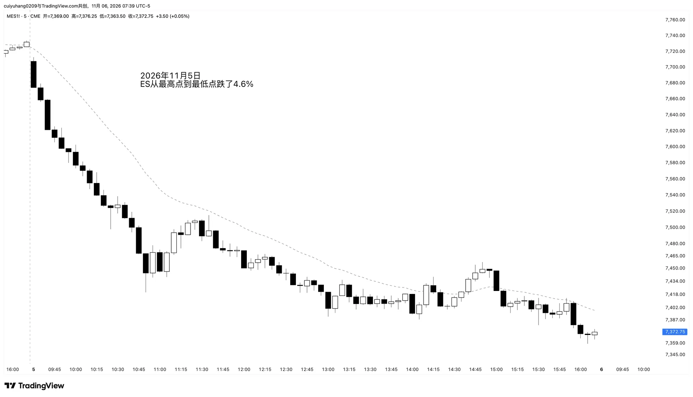

import ImageCases from "@/components/ImageCases.astro";
import ResearchCard from "@/components/ResearchCard.astro";
import prompt from "./prompt.txt?raw";
import code from "./open-selloff.py?raw";

export const picks = Object.entries(import.meta.glob("./picks/*.webp", { eager: true, import: "default" }))
  .sort(([a], [b]) => (a < b ? -1 : 1))
  .map(([path, img]) => {
    const d = path.slice(-15, -5);
    const w = "日一二三四五六"[new Date(d + "T12:00:00Z").getUTCDay()];
    return { img, alt: `${d} 开局抛售`, note: `<b>${d} 周${w}</b>` };
  });

> **一句话结论**：ES 日盘开盘前 20 根 5 分钟 K 线里，出现一段几乎根根阴线、高点一级级往下的连绵抛售，16 年里有 **260 天**，平均一年 16 次。这段抛售走完以后，当天 **53% 震荡区间，26% 趋势恢复，20% 反转**。Al Brooks 说的是 60 / 20 / 20，数据很接近。

Al Brooks 讲过一条经验：一天开盘就遇到大抛售，后面大约 60% 是震荡区间，20% 大反转，20% 趋势恢复。

我想验证的是更具体的一种开盘：不是随便跌得多就算，而是一开盘就**连绵不断**地抛售，十几根 K 线几乎根根阴线，中间只夹着很小的兜底阳线，高点一级一级往下，几乎没有像样的反弹。比如下面这天：

2026-11-05 的 5 分钟图。开盘第 1 根就是大阴线，之后几乎根根阴线，一直卖到 10:50 左右；反弹到 11:30 又开始往下磨，收在全天最低点附近。从最高点到最低点跌了 4.6%。

这篇想回答的是：这样的抛售走完以后，接下来会出现什么样的跟随？

## 1. 什么样的开盘算"连绵抛售"

我要找的是开盘没多久就被一路往下卖的日子。大致有两种样子，占一种就算，两种都占更典型：

- **几根特别大的阴线**：三到五根大阴线，一下就砸下去一大截。
- **一根接一根不算大的阴线**：每根不大，但连着往下走，中间几乎不反弹。

不管哪种，阳线都很少，有也只是很小的兜底阳线。

为了能拿 16 年的数据来统计，我把这个意思写成了 6 条规则（"一段"指这段抛售从最高点到最低点）：

1. 发生在开盘后不久：第 1 到第 10 根之间开始往下卖，最晚第 22 根卖完。
2. 一段至少 6 根 K 线；不到 10 根的话，得根根都是阴线。
3. 阳线很少：阴线至少占三分之二，每根阳线的实体不超过整段跌幅的一成，只能是兜底的小阳线。
4. 中间至少连着 8 根，没有一根像样的阳线。
5. 高点一根比一根低：至少四分之三的 K 线高点比前一根低；中途就算反弹，收盘回不到整段跌幅的两成，最高也碰不到三成半。
6. 跌得够多：前 20 根里跌掉的，至少是当年平常一天波幅的六成。

## 2. 我手动挑出的 155 天

机器按这 6 条选出了 300 多天，我又手工筛选了两遍，基于两个准则：要么几根大阴线砸得特别狠，要么有持续不断的卖压，并且中间没什么多头 K 线。

<ImageCases title="我手动挑出的 155 天开局抛售" items={picks} />

## 3. 震荡区间 53%、趋势恢复 26%、反转 20%

抛售走完以后，按**收盘**收在哪里分三类：

- **趋势恢复**：收盘比这段的最低点还低，而且低出至少四分之一段。
- **反转**：收盘收回这段跌幅的八成以上。
- **震荡区间**：收盘在两者之间。

| 切点（趋势恢复 / 反转） | 趋势恢复 | 震荡区间 | 反转 |
|---|---:|---:|---:|
| **低出 0.25 段 / 收回八成（本文用的）** | **26%** | **53%** | **20%** |
| 收在最低点之下 / 收回八成 | 35% | 45% | 20% |
| 低出 0.5 段 / 收回八成 | 19% | 60% | 20% |
| 低出 0.25 段 / 收回七成 | 26% | 49% | 25% |
| 低出 0.25 段 / 完全收回 | 26% | 58% | 15% |

切点怎么挪，震荡区间都在一半左右，趋势恢复和反转各占两成到三成。Brooks 的 60 / 20 / 20 基本对得上。

三类各自长什么样：

| 抛售走完以后 | 趋势恢复 | 震荡区间 | 反转 |
|---|---:|---:|---:|
| 天数 | 68 | 139 | 53 |
| 再创新低 | 100% | 76% | 49% |
| 再跌多远（中位数） | 0.96 段 | 0.18 段 | 0 |
| 最大反弹（中位数） | 0.41 段 | 0.68 段 | 1.59 段 |
| 收盘位置（中位数） | −0.69 段 | 0.32 段 | 1.33 段 |
| 这段抛售跌了（中位数） | 1.03% | 0.81% | 0.79% |

- **趋势恢复的那 26%**：几乎又走出一整段（相当于走出了 AB = CD），中间反弹不到一半。抛售本身也更大，中位数 1.03%。跌出四分之一段新低的时间中位数是 12:35，但全天最低点 91% 在 14:00 以后、79% 在最后一小时，也就是一直卖到收盘。图上常见的样子是：抛售走完先横一两个小时，下午再往下破。
- **震荡区间的那 53%**：大多还会再创一个小新低（0.18 段），反弹到七成左右，收在最低点上方三成。
- **反转的那 20%**：一半的日子根本没再创新低，这段的最低点就是全天最低点；反弹中位数 1.59 段，收在起点之上。收回八成的时间中位数是 12:40，38% 要到 14:00 以后才收回，反转大多是慢慢磨上去的，不是 V 形。

## 4. 抛售走完以后的跟随

- **很快再创新低，但走不远**：77% 会再创新低，中位数只再跌 0.25 段；七成在半小时内就出现。
- **反弹多半到一半**：到一半的 67%，到八成的 40%；但到了八成的，有一半收盘守不住。
- **低点多半会被回测，回测时多半会破一下**：71% 会回头测试低点，其中 63% 会再破一点，但破了也走不远。
- **全天最低点**：23% 就是这段抛售的最低点，28% 在 15:00 以后，后者多数是趋势恢复的那类。

## 5. 一小时后有没有新低

抛售走完再等一小时（12 根），三类的比例会明显变：

| 走完后 1 小时内 | 天数 | 趋势恢复 | 震荡区间 | 反转 |
|---|---:|---:|---:|---:|
| 跌出 ≥0.25 段的新低 | 43 | **51%** | 42% | 7% |
| 没创新低 | 98 | 16% | 54% | **30%** |
| 反弹 ≥0.5 段 | 92 | 17% | 49% | **34%** |

- 一小时内跌出四分之一段以上的新低：趋势恢复升到 51%，反转只剩 7%。
- 一小时内没创新低，或者已经反弹过半：反转升到三成左右。

第二天没什么特别：收阳 57%，和平常的 55% 差不多；52% 会跌破今天的最低价。

## 6. 对交易的启发

- **走完的那一刻别追空**：一半以上是震荡区间。
- **也别急着抄底**：77% 还会再创新低，止损放在最低点下方四分之一段左右。
- **反弹先看一半**：到一半的 67%，到八成的 40%。
- **回测低点多半会破一下**：等破了收回来再做多，比直接在低点做双底稳。
- **一小时后看新低**：跌出四分之一段以上的新低，按趋势恢复准备；没创新低、反弹过半，反转的可能变大。

## 定义和复现

<ResearchCard title="开局连绵抛售之后" prompt={prompt} code={code}>

- **数据**：清洗后的 ES 1 分钟 K 线，2010-06 到 2026-09，共 3924 个交易日，清洗方法见[这篇](/posts/data-cleaning/)。
- **日盘**：美东 09:30–16:15，合成 5 分钟 K 线，一天 81 根。
- **开局连绵抛售**：第 1 节的 6 条规则。同一天有几种切法都满足时，取跌得最多的那一段。
- **一段**：这段抛售起点那根的最高价到终点那根的最低价。文中"几段"都是用它做尺子：0 是这段的最低点，1 是这段的起点，负数是跌出了新低。
- **三分法**：收盘位置 < −0.25 算趋势恢复，≥ 0.8 算反转（和我给 day type 定反转用的"收回八成"一致），中间算震荡区间。
- **再创新低 / 再跌多远**：段尾之后当天的最低价低于这段的最低价；低了多少，除以一段。**最大反弹**：段尾之后当天的最高价减这段的最低价，除以一段。
- **测试低点**：段尾之后先有 K 线的最高价 ≥ 最低点 + 0.3 段，之后又有 K 线的最低价 ≤ 最低点 + 0.1 段。回来以后再跌到最低点 − 0.1 段以下算"破了"。
- **走完后 1 小时**：段尾之后的 12 根 K 线。
- **第二天**：要求和今天用同一张合约，中间没有被清洗掉的日子。

</ResearchCard>
