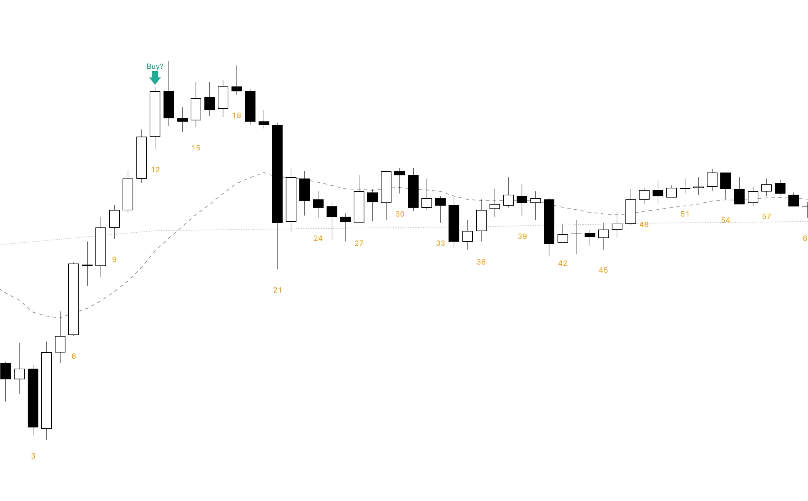

import OpenBarsExplorer from "@/components/OpenBarsExplorer.astro";
import ResearchCard from "@/components/ResearchCard.astro";
import prompt from "./prompt.txt?raw";
import code from "./openbars.py?raw";

> **一句话结论**：ES 日盘开盘的前两根 60 分钟 K 线（09:30–11:30）都收阳，**84.5%** 的日子全天收阳；都收阴，79.9% 的日子全天收阴。这种开盘大约每两天出现一次。
>
> 但这个高胜率大部分已经"花掉了"：在第二根收盘（11:30）追买，收盘时还赚钱的只有 **56.3%**，和随便哪天买差不多。
>
> 作用：开盘两小时都收阳时，更该用的是另外两个数字：全天最低点已经出现的概率 77.5%，之后还会创新高的概率 82.0%。适合等回调做多、止损放在当天低点下面，而不是在 11:30 追进去。

我以前做突破的时候，经常一看到开盘一连串的阳线，就迫不及待地追进去，几乎是恐慌性地买入，FOMO 完全占据了我。可进场以后，常常发现自己买在了山顶。

Al Brooks 常说，强趋势里可以在收盘时买进（Buy the Close）。那开盘出现一串阳线，算不算这样的趋势？什么时候是顺势买收盘，什么时候只是在追高？

2026-10-21 的 5 分钟图。开盘第 4 根以后几乎根根收阳，第一根 60 分钟 K 线收得很强。如果在第 12 根收盘（10:30，也就是第一根 60 分钟 K 线收盘）追进去，正好买在当天最高点附近：之后横了几根，第 21 根一根大阴线直接跌回均线下面，这一天再也没有回到买入价。

为了回答这个问题，我用 ES 2010–2026 年的数据统计了开盘连续同色 K 线之后，这一天会怎样收。主要看 60 分钟图，也看了 5、15、30 分钟图上开盘连续几根同色的情况。

<OpenBarsExplorer />

## 前两根 60 分钟都收阳：84.5% 收阳

| 前两根 60 分钟 | 都收阳 | 都收阴 |
|---|---:|---:|
| 出现 | 1062 天（27.1%） | 874 天（22.3%） |
| 全天同色 | **84.5%** | **79.9%** |
| 收在第 2 根收盘之外 | 56.3% | 45.7% |
| 反方向的极值已出现 | 77.5% | 74.9% |
| 之后还创新高（新低） | 82.0% | 75.1% |

- **很常见**：两种合计 49.4%，差不多每两天就有一天开盘两小时是同一个颜色。
- **全天同色的比例很高**：收阳 84.5%，收阴 79.9%。
- **阴线比阳线弱一点**：每一项都是阴线低几个百分点，这和 ES 这 16 年整体偏多有关。

## 为什么追进去只有 56%

"全天收阳"比的是收盘价和**开盘价**。到 11:30，两根阳线已经走完了，当天大概率已经涨了不少，收盘只要不跌回开盘价就算收阳。所以 84.5% 里，大部分是**已经发生的事**。

真正能交易的问题是：11:30 看到信号再进场，从这里到收盘还能不能赚？

- 两根阳线之后，收盘高于第二根收盘的只有 **56.3%**。所有日子里收阳的比例是 54.6%，两者差不多。
- 两根阴线之后更明显：收盘低于第二根收盘的只有 **45.7%**，不到一半。也就是说，开盘两小时都跌的日子，后面更常见的是往上收回一点。

所以开盘两小时同色，告诉你的是"今天大概率收在哪一边"，而不是"现在进场还有多少肉"。

## 更有用的两个数字

开盘两小时都收阳时：

- **全天最低点已经出现：77.5%**。做多的止损放在当天低点下面，大约八成的日子不会被打到"全天新低"。
- **之后还会创新高：82.0%**。11:30 以后还有八成的日子会高过上午的最高点，所以上午的高点是一个可以看的目标，而不是顶。

两根阴线时对称的数字是 74.9% 和 75.1%，比阳线弱一些。

## 连续 6 根都收阳：尾盘并没有大跌

在图上把 60 分钟图看到第 6 根，会发现"之后还创新高"从第 5 根的 84.4% 掉到了 66.7%。看起来像是尾盘大家都在卖出多头仓位，但数据不是这样：

- 开盘连续 6 根 60 分钟都收阳的有 87 天。第 6 根在 15:30 收线，当天只剩最后 45 分钟。
- 这 87 天里，收盘比 15:30 还高的有 55.2%；尾盘跌超 0.3% 的只有 3 天。收盘离全天最高点，一般只差全天波幅的 11%，基本收在高点附近。
- 所以"之后还创新高"变少，主要是因为剩下的时间太短，来不及再创新高。尾盘有人获利了结，更多表现为停在高点附近，而不是一路往下跌。

## 换成更短的 K 线

在 5、15、30 分钟图上，开盘连续同色的信号弱很多：

| 开盘前 N 根都收阳 | 全天收阳 |
|---|---:|
| 5 分钟 × 2 根（到 9:40） | 67.1% |
| 15 分钟 × 2 根（到 10:00） | 72.9% |
| 30 分钟 × 2 根（到 10:30） | 78.1% |
| 60 分钟 × 2 根（到 11:30） | 84.5% |
| 60 分钟 × 3 根（到 12:30） | 93.6% |

规律很直接：信号用掉的时间越长，"全天收阳"越高，但留给你的时间和空间也越少。而"收盘高于信号收盘"，在样本超过 100 天的阳线组合里都只有 51%–61%，没有哪一种能明显超过"随便哪天买"的水平。

## 定义和复现

<ResearchCard title="开盘连续同色 K 线" prompt={prompt} code={code}>

- **数据**：清洗后的 ES 1 分钟 K 线，2010-06 到 2026-09，共 3924 个交易日，清洗方法见[这篇](/posts/data-cleaning/)。
- **日盘**：美东 09:30–16:15。5、15、30、60 分钟 K 线都从 09:30 开始切，最后一根不满也算一根（60 分钟的最后一根是 15:30–16:15）。
- **阳线 / 阴线**：收盘 > 开盘是阳线，收盘 < 开盘是阴线，相等的两边都不算。
- **信号**：开盘的前 N 根全是阳线（或全是阴线）。
- **全天收阳**：日盘收盘价 > 日盘开盘价，也就是日 K 线是阳线。
- **收盘高于信号收盘**：日盘收盘价 > 第 N 根的收盘价。
- **全天最低点已出现**：全天日盘的最低价出现在前 N 根里。
- **之后还创新高**：第 N 根以后，还有 K 线的最高价高于前 N 根的最高价。

</ResearchCard>

## 局限

- **只看收盘，不看过程**："收盘高于信号收盘"不代表中间没有先跌很多，止损和目标需要另外研究。
- **没有区分 K 线大小和形状**：两根大阳线和两根小阳线，意义可能不一样；第二根是不是内包线、收在哪里，这里都没有分。
- **没有结合开盘位置**：比如高开以后的两根阳线和低开以后的两根阳线，意义可能不一样。
