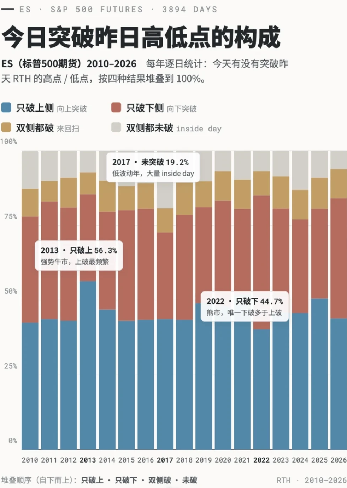

> **一句话结论**：**89.8%** 的日子，会突破昨日高低点的至少一侧。

最近看阿布先生的过往直播，听到他提及很多次关于昨天高低点的 90% 定理。我用 ES 16 年的数据做了个回测，3894 个完整交易日，专门看一件事：今天会不会突破昨天的最高点或最低点。

## 结论很明确

**89.8%** 的日子，会突破昨日高低点的至少一侧。

这个数字几乎完美对应了 Al Brooks 说的“90% 法则”。而且很稳定，16 年里逐年的命中率都在 80% 到 94% 之间，没有任何一年掉到 80% 以下。

也就是说，**昨日的高点和低点，是图表上最可靠的两个磁吸位**。开盘前把它们标出来，今天大概率会去测试其中至少一个。

## 剩下的 10%

剩下的 10% 里，又分两种：

- **双侧都没突破（10.2%）**：相当于今天被关在昨天的区间里，是 inside day。
- **双侧都突破（9.1%）**：先破一边又反向破另一边，通常是大波动或者来回扫的混乱日。

这两种都比较少见，也都是突破策略容易失败的日子。

## 一个偏向：上破比下破多

只破上侧的有 **46.1%**，只破下侧的只有 **34.5%**，差了 11 个百分点。原因也简单，2010 到 2026 这段整体是牛市，向上突破自然更频繁。

但有个例外是 **2022 年**，那年是熊市，成了唯一一个下破多于上破的年份（44.7% vs 40.2%）。所以这个偏向是市场环境给的，不是永远成立，遇到熊市要切换。

## 最后一个观察：命中率本身能反映市场状态

**2017 年**命中率最低（80.8%），那年波动极小，很多天闷在区间里；**2020、2022** 这种巨震或单边的年份，命中率都到 93% 以上。

所以当你发现昨日高低点频繁被突破，说明市场进入了活跃期；当频繁出现 inside day，说明在盘整，这时候突破策略就该收手。

## 定义说明

为了防止误解，回测里“突破昨天的高低点”的定义是：今天的某一个价格至少有一次**高于**上一个交易日 RTH 的最高价（向上突破），反之亦然。即高开在昨天高点之上，也算突破。

（本文首发于小红书。）
