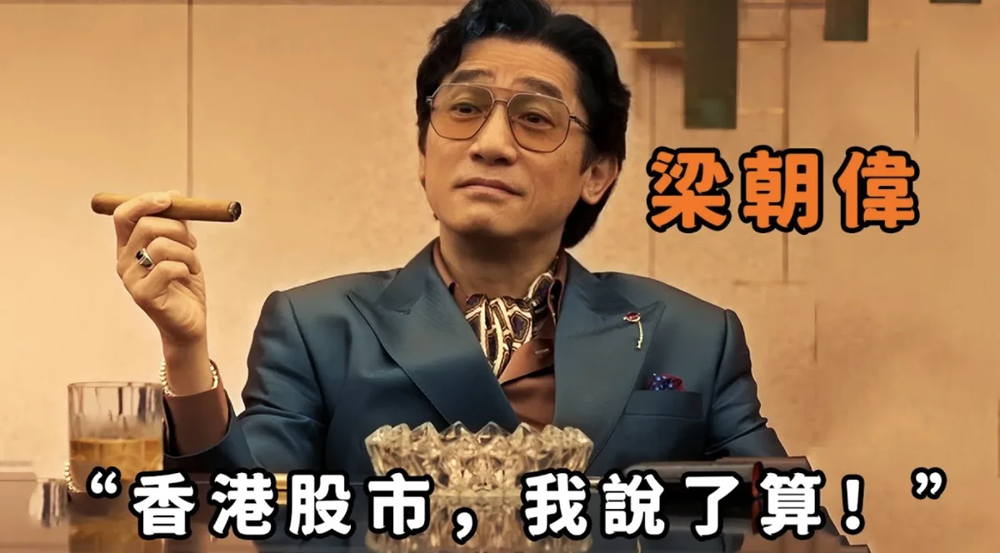

电影《金手指》（2023）剧照。梁朝伟饰演的程一言是个靠做局操纵股价起家的大亨，原型是 1980 年代香港的佳宁集团案。

## 总结

- **小盘股、早期 A 股确实有人坐庄**，这一点不否认。
- **大盘股很难被专门针对**：以苹果为例，开盘两小时散户只成交了约 12 亿美元，机构要推动价格去“收割”这部分钱，自己付出的成本远大于能赚到的。
- **真正天天和散户做对手的是做市商**：他们承接散户的大部分订单，靠买卖价差赚钱，不靠操纵价格。
- **对交易 ES 的人来说**，更有用的问题不是“谁在针对我”，而是“机构现在在做什么”。

## 为什么总觉得有人在操纵

### 1. 早期市场制度不完善

A 股在 1990 年代初建立，市场化程度有限，法律和监管框架还不健全。当时上市公司质量参差不齐，信息披露不透明，监管执法也偏弱。

在这种环境下，确实有资金实力较大的机构或个人，通过集中资金、控盘拉升来影响股价。这就是大家说的“庄家坐庄”。

### 2. 散户占主导的市场结构

和美股不同，A 股长期以散户交易为主，散户成交占比曾经在 80% 以上。散户的特点是信息不对称、追涨杀跌，容易被资金推动的短期行情“收割”。

所以每当价格异常波动，散户就容易觉得有人在背后操纵。赚钱时觉得是自己有眼光，亏钱时觉得有人针对自己。

### 3. 典型的历史案例

- <strong>“德隆系”事件（2004）</strong>：控股多家上市公司、资金在公司之间循环，长期操纵股价，最后资金链断裂爆雷。
- <strong>中小板和创业板早期炒作</strong>：很多小盘股被游资席位集中拉抬，短期暴涨暴跌，有明显的坐庄特征。

**结论：在小盘股和早期 A 股，坐庄是真实存在的。** 下面要讨论的是另一个问题：在苹果这样的大盘股里，机构会不会专门针对散户？

## 大盘股为什么很难被“针对”：以苹果为例

2025 年 9 月 10 日，苹果秋季发布会的第二天，苹果（AAPL）全天成交约 **8344 万股**，价格在 226–232 美元之间，收盘 226.79 美元。

美股一天的成交量大致呈 U 形，开盘和收盘最集中。假设开盘后两小时占全天的 25–30%，就是约 2100–2500 万股，按 229 美元算，**成交额约 48–57 亿美元**。

摩根大通的统计是，散户平均占美股成交量的 **20–25%**。按中间值算，这两小时里：

<figure class="day-funnel">

苹果开盘两小时成交额（估算）<strong>约 52 亿美元</strong>

<ul class="day-funnel-legend">
<li><i class="seg-keep"></i>机构和其他<b>约 40 亿</b></li>
<li><i class="seg-roll"></i>散户<b>约 12 亿</b></li>
</ul>
<figcaption>按全天成交 8344 万股、开盘两小时占 27.5%、均价 229 美元、散户占比 22.5% 估算，条形按金额等比例画。</figcaption>
</figure>

### 能“收割”的钱有多少

假设机构真的能让价格朝不利于散户的方向走 **1%**，而且所有散户都站错了方向，散户合计也只会亏 **约 1200 万美元**（12 亿 × 1%）。

### 要付出的代价有多大

推动价格不是“砸钱”这么简单。苹果的盘口很厚，买卖双方随时都有大量挂单。想把价格推高 1%，就得一路吃掉对面挂着的卖单，越往上成交价越差。在两小时 50 多亿美元的成交里推动价格，机构自己要买卖的规模至少是几亿到几十亿美元。

推上去以后还得平仓，这时又要在越来越差的价格上卖出，再付一次冲击成本。中间还有三个风险：

- **高频交易抢在前面**：大单的痕迹会被量化机构识别，对方会提前买入，抬高机构的成本；
- **价格回落**：一离开，价格就可能回到原位，之前的冲击成本全白付；
- **监管风险**：在美股，操纵价格是重罪。

一边是最多一千多万美元的收益，一边是在几十亿美元的盘子里来回冲击的成本和风险，**这笔账算不过来**。机构真正的对手是其他机构，散户的体量太小，不值得专门针对。

## 真正和散户做对手的是谁：做市商

散户在美股下的单，大多数没有直接送到交易所，而是被券商卖给了做市商（这叫“订单流付费”，英文 PFOF）。做市商同时报出买价和卖价，散户买时卖给他们，散户卖时从他们手里买，他们赚中间的价差。

这门生意规模很大：

- 头部做市商 Citadel Securities 自己披露，2020 年它承接了美国约 **46%** 的散户订单；
- 按 2025 年的监管文件汇总，做市商每年为购买美国股票和期权的订单流支付**超过 49 亿美元**。

做市商愿意花钱买散户的订单，正是因为散户的单子小、方向分散，和他们成交风险低，稳稳赚价差。**机构从散户身上赚钱的真实方式，是吃价差、在散户追涨杀跌时提供对手盘，而不是专门砸盘。**

## 散户、长线机构、做市商：三方对比

| | 散户 | 长线机构 | 做市商 / 高频 |
|---|---|---|---|
| 单笔资金 | 数千～数万美元 | 数百万～数亿美元 | 单笔小，总量极大 |
| 持仓时间 | 几分钟到几天 | 几个月到几年 | 几秒到几分钟 |
| 怎么赚钱 | 赚价格涨跌 | 赚公司长期增长 | 赚买卖价差 |
| 对价格的影响 | 分散，几乎没有 | 大单会推动价格 | 提供流动性，让价格更稳 |
| 典型弱点 | 追涨杀跌、止损执行差 | 大单难以隐藏 | 行情剧烈时容易被单边行情打穿 |

## 这对交易 ES 意味着什么

我交易的 ES（标普 500 E-mini 期货）比苹果的盘子更大，成交几乎全来自机构。

Al Brooks 的价格行为体系有一个基本前提：**能推动价格的只有机构，散户的单子对价格没有影响。** 所以图上的每一根 K 线、每一段趋势，反映的都是机构在买或卖。散户能做的，是读懂机构现在在做什么：是在推趋势，还是在区间里高抛低吸，然后顺着他们的方向交易。

“止损总被扫”的感觉也可以这样理解：价格走到前高、前低这些位置，是因为那里本来就有很多机构的计划单，有人在那里加仓，有人在那里止损。价格去那里，是因为那里有足够的成交，而不是有人专门盯着你的那张单子。

**与其问“谁在针对我”，不如问“机构现在在做什么”。** 这才是散户真正能用上的问题。

## 数据来源

- 苹果 2025-09-10 成交量和价格：[TipRanks 历史价格](https://www.tipranks.com/stocks/aapl/historical-prices)
- 散户占美股成交量 20–25%（摩根大通）：[Benzinga](https://www.benzinga.com/markets/tech/26/01/49671587/retail-investors-historic-2025-streak-record-inflows-record-influence)
- Citadel Securities 承接约 46% 散户订单（2020 年）：[Quartz](https://qz.com/1969196/citadel-securities-gets-almost-as-much-trading-volume-as-nasdaq/)
- 做市商每年为订单流支付超过 49 亿美元（2025 年 5 月）：[Global Trading](https://www.globaltrading.net/payment-for-us-retail-flow-reaches-record-high-led-by-citadel-securities-imc/)
- 开盘两小时占全天成交 25–30% 是按美股日内成交量 U 形分布做的假设，不是当天的实际数字。

（2026 年 9 月 15 日第一次发布，10 月 18 日修改：改正了计算错误，补充了做市商和对交易 ES 的意义。）
